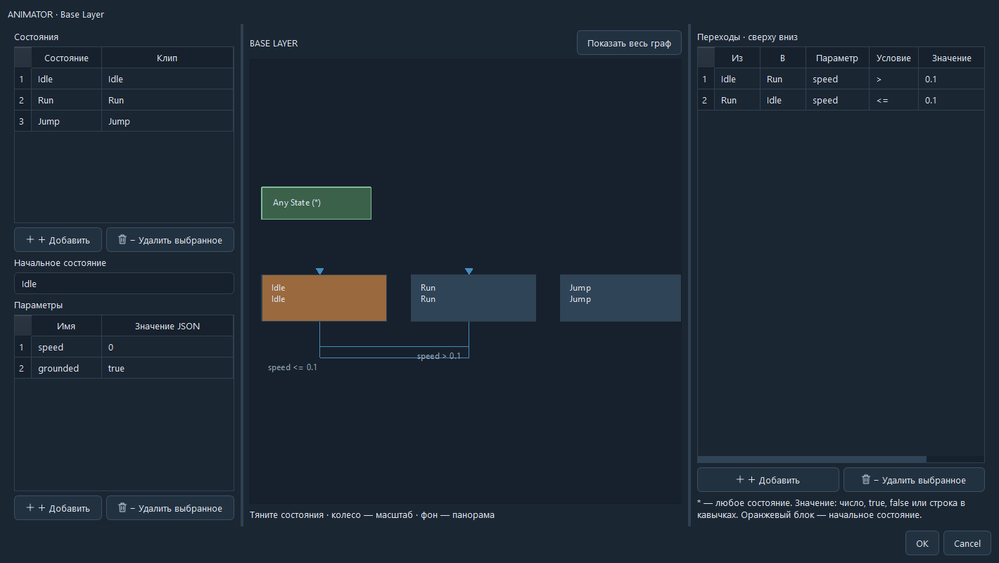
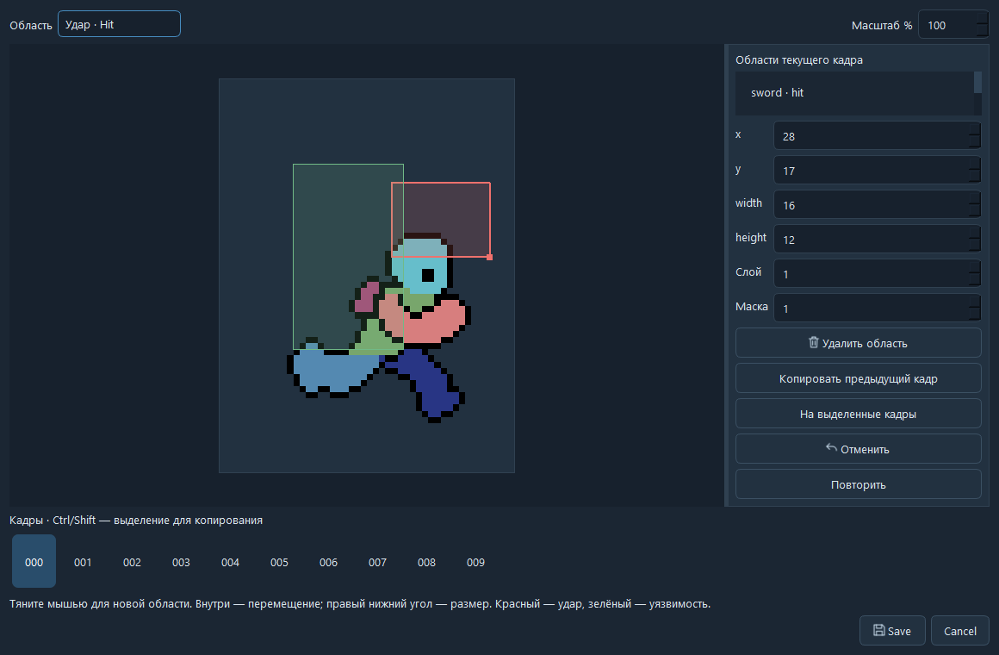
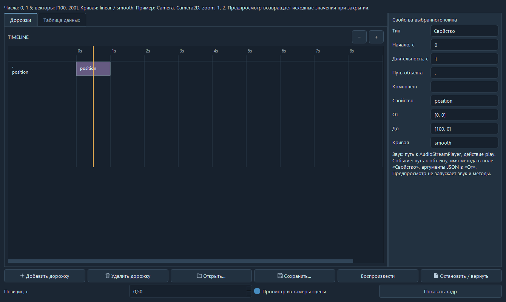
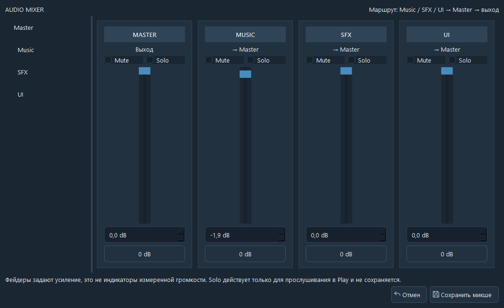

<p align="center">
  
</p>

<p align="center">
  <strong>Игровой движок от Cloud Team</strong><br>
  Редактор, инструменты и игровой runtime для ваших 2D-проектов.
</p>

<p align="center">
  <a href="#бета-тест">Бета-тест</a> ·
  <a href="#возможности">Возможности</a> ·
  <a href="#интерфейс">Интерфейс</a> ·
  <a href="docs/README.md">Документация</a> ·
  <a href="docs/CLOUD_SCRIPTS.md">Cloud Script</a> ·
  <a href="https://discord.gg/ZP7ATwuDND">Discord</a>
</p>

---

## Cloud Engine

Мы делаем Cloud Engine для собственных игр и делимся инструментами с другими разработчиками. Сцены, компоненты, ресурсы и скрипты находятся в одном рабочем пространстве. Игровые правила остаются в вашем коде.

Текущая версия — **1.2.0.7**. Движок находится на этапе бета-тестирования.

## Бета-тест

| | |
| :--- | :--- |
| **Система** | Windows 10 / 11, x64 |
| **Установка** | `CloudEngine-1.2.0.7-Setup.exe` из раздела **Releases** репозитория |
| **Python** | Для готовой сборки не требуется |
| **Перед запуском** | Сделайте копию проекта |

Установщик публикуется отдельным файлом в Releases. Исходники из этого репозитория нужны для разработки движка, а не для обычного запуска.

Ошибку можно описать во вкладке **Issues**: укажите шаги воспроизведения, ожидаемый результат и то, что произошло. Приложите скриншот и, по возможности, небольшой проект без личных данных.

## Возможности

| Создание игры | Работа с проектом |
| :--- | :--- |
| Сцены и система компонентов | Импорт и обновление ресурсов |
| TileMap, слои и коллизии | Сохранение, отмена и восстановление |
| Анимации и покадровые хитбоксы | Cloud Script и диагностика ошибок |
| Камера, параллакс, свет и частицы | Плагины и готовые шаблоны |
| Кат-сцены и аудиомикшер | Экспорт игры под Windows |

Для macOS сборка выполняется на Mac; экспорт исходников под другую ОС не является готовым приложением.

## Интерфейс

### Анимация и бой

Граф состояний Animator, параметры и переходы. Отдельные области атаки и уязвимости для каждого кадра спрайта.



<details>
<summary><strong>Редактор покадровых хитбоксов</strong></summary>



</details>

### Кат-сцены и звук

Дорожки объектов, камеры, звука и событий; настройка клипов на таймлайне. В микшере — Master, Music, SFX и UI.



<details>
<summary><strong>Аудиомикшер</strong></summary>



</details>

## Запуск из исходников

Нужен **Python 3.12 или 3.13**. Команды для Windows:

```powershell
python -m venv .venv
.venv\Scripts\python.exe -m pip install -r requirements.txt
.venv\Scripts\python.exe main.py --interface classic
```

<details>
<summary><strong>Тесты и сборка EXE</strong></summary>

```powershell
New-Item -ItemType Directory -Force build
.venv\Scripts\python.exe -m unittest discover -s tests -p "test_*.py"

.venv\Scripts\python.exe -m pip install pyinstaller
.venv\Scripts\python.exe build_exe.py --onefile --interface classic --output dist
```

Для Windows-загрузчика используется компилятор .NET Framework. Для установщика дополнительно нужен Inno Setup Compiler:

```powershell
.venv\Scripts\python.exe build_installer.py --compiler "C:\Program Files (x86)\Inno Setup 6\ISCC.exe" --source dist\CloudEngine.exe --output installer-output
```

</details>

## Структура проекта

```text
engine/       Ядро, сцены, компоненты и runtime
editor/       Интерфейс и инструменты
plugins/      Плагины редактора
templates/    Шаблоны проектов
tests/        Автоматические проверки
docs/         Руководство и Cloud Script
launcher/     Загрузчик Windows
installer/    Установщик
```

## Участие в разработке

Баг-репорты и небольшие исправления помогают развитию движка. Для крупного изменения сначала создайте Issue и опишите задачу. В Pull Request укажите, что изменилось и как это проверить.

**Лицензия программного кода — GPL v3.** Сторонние библиотеки и графические материалы сохраняют собственные условия использования.

---

<p align="center">
  <strong>Cloud Team</strong><br>
  <a href="https://discord.gg/ZP7ATwuDND">Сообщество разработчиков</a>
</p>
